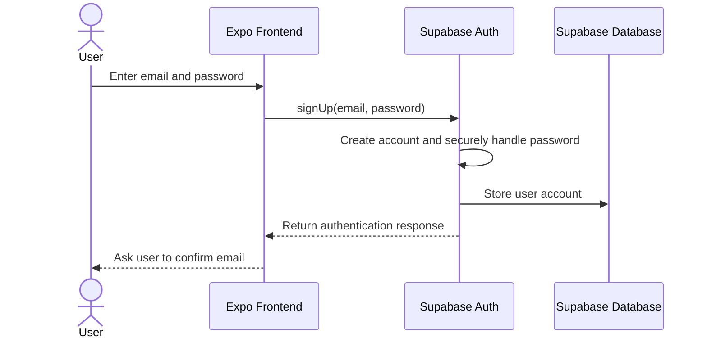
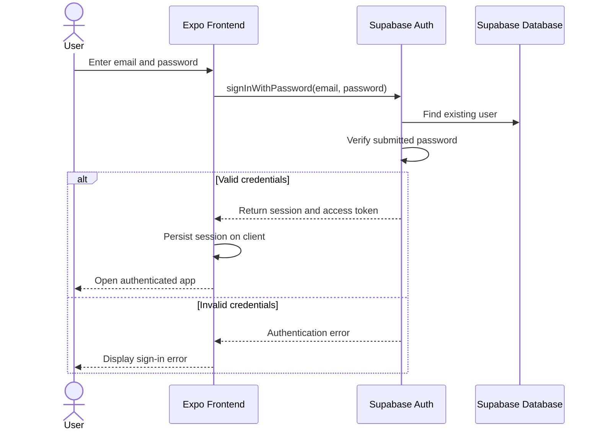
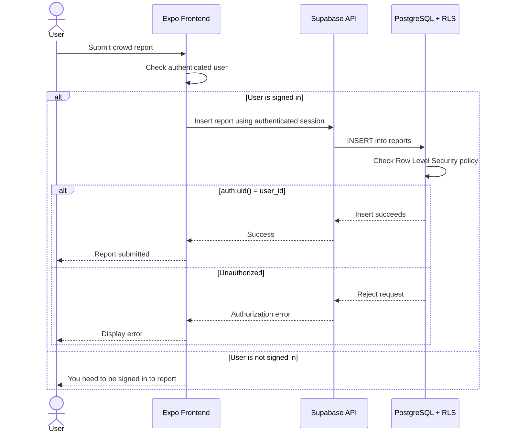

# Musty Maps

## TE6: Adding Access Control

Musty Maps uses Supabase Auth for authentication and Supabase/PostgreSQL for the backend and database. Supabase handles account creation, password authentication, session management, and access tokens.

### Sign-Up Flow

### Sign-In Flow

### Protected Report Submission

