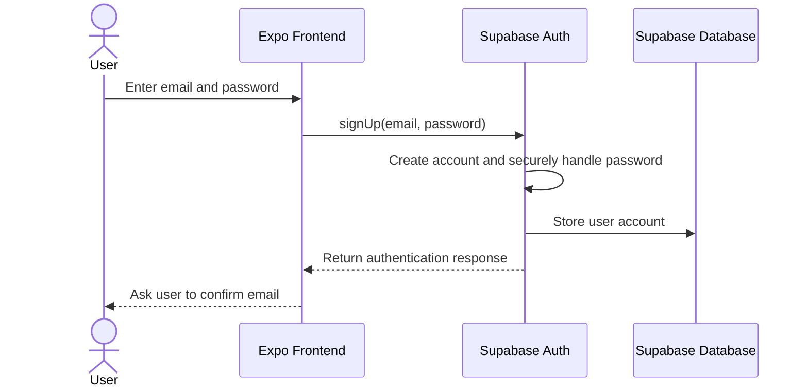
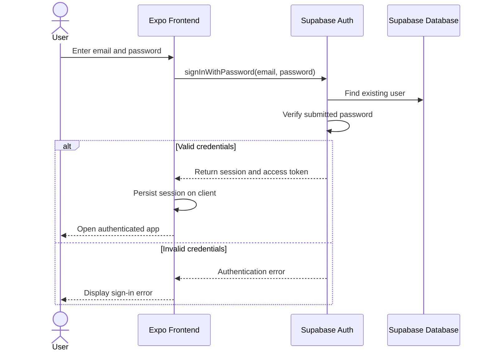
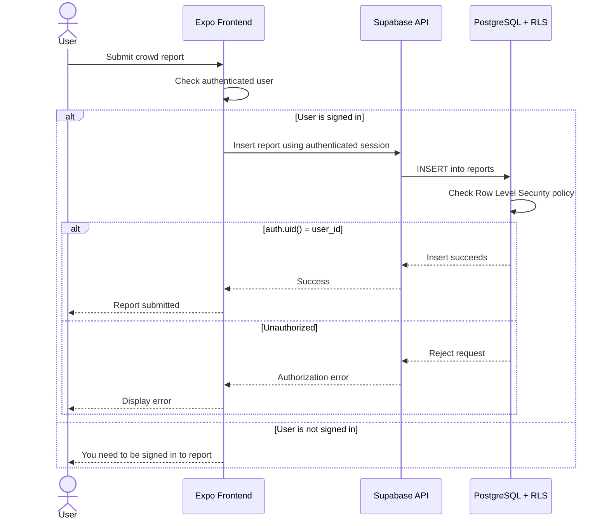

# Musty Maps

## TE6: Adding Access Control

Musty Maps uses Supabase Auth for authentication and Supabase/PostgreSQL for the backend and database. Supabase handles account creation, password authentication, session management, and access tokens.

### Sign-Up Flow



### Sign-In Flow



### Protected Report Submission


## Access Control Implementation

### Frontend Session Storage

The Supabase client stores and restores the authenticated session on the frontend.

File:
`packages/frontend/src/lib/supabase.ts`

```ts
auth: {
  storage: localStorage,
  autoRefreshToken: true,
  persistSession: true,
  detectSessionInUrl: false,
},
```

### Sign In

Existing users sign in through Supabase Auth using the email and password entered on the frontend. The sign-in logic is located in `packages/frontend/src/stores/authStore.ts` and uses `supabase.auth.signInWithPassword({ email, password })`. Supabase checks the submitted credentials and, when they are valid, creates an authenticated session for the user. The session is then stored on the frontend using the session storage configuration described above.

### Sign Up

New users are created through Supabase Auth using the sign-up logic in `packages/frontend/src/stores/authStore.ts`. The app calls `supabase.auth.signUp({ email, password })` with the information entered by the user. Supabase handles creating the account and securely storing the user's authentication information. After account creation and confirmation, the user can sign in and receive an authenticated session.

### Protected Report Submission

Submitting a crowd report is one of the protected actions in the app. The logic is located in `packages/frontend/src/services/locationService.ts`. Before a report is submitted, the app calls `supabase.auth.getUser()` to check whether there is currently an authenticated user. If no authenticated user exists, the request stops and the app returns the message `You need to be signed in to report.` If the user is authenticated, the app sends the report through the Supabase client and includes the authenticated user's ID as the `user_id` for the report.

The Supabase client uses the current authenticated session when making the request, so the backend can determine which user is making the request.

### Backend Authorization

The backend access-control rules are defined in `supabase/migrations/001_initial_schema.sql`. Row Level Security is enabled on the `reports` table. The `reports_insert` policy only allows a report to be inserted when `auth.uid()` matches the `user_id` of the report being submitted. This means an unauthenticated user cannot create a report, and an authenticated user cannot create a report while pretending to be another user.

The `profiles` table is also protected with Row Level Security. Its policy checks that `auth.uid()` matches the profile's `user_id`, so users can only access or modify their own profile data.

Together, Supabase Auth, persisted frontend sessions, authenticated Supabase requests, and Row Level Security provide the access-control system for Musty Maps.